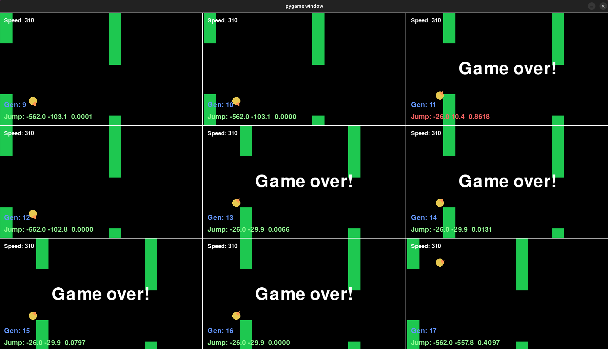

This is an old project I did to teach myself neural networks and reinforcment learning.

# Flappy Bird Bot

Flappy Bird clone written in Python + pygame. A population of birds, each controlled by a small neural network, learns to play via a genetic algorithm (no backprop): keep the best, mutate copies, repeat.



## How it works

- **Network** (`network.py`): fully connected, sigmoid activations. Default is 2 inputs → 2 hidden layers of 8 → 1 output. Output > 0.5 means "flap".
- **Inputs** (`Game.State()`): horizontal distance to the next pipe and vertical distance from the bird to the top of that pipe's bottom half.
- **Agent** (`agent.py`): one bird + one network. Score is the median survival time (in steps) over 4 runs on random pipe layouts.
- **Population** (`population.py`): evaluates all agents in a `multiprocessing.Pool`, sorts by score. The top `keep_perc` survive. The rest are replaced by mutated clones of the survivors.
- **Trainer** (`trainer.py`): runs generations in a background thread and stores the best agent of each.
- **Game** (`game.py`): bird physics, pipes, and speed that increases with points. The gap between pipes is randomized but kept reachable.
- **Viewer** (`test.py`): pygame window that replays the best agents of recent generations on a fixed seed while training continues.

## Setup

```bash
python3 -m venv venv
source venv/bin/activate
pip install -r requirements.txt
```

## Run

```bash
python test.py
```

Training starts immediately in the background. The window shows the top agents so far (1 → 2x2 → 3x3 grid as generations accumulate).

### Controls

| Key | Action |
|-----|--------|
| `M` | toggle grid mode (all birds in one scene vs. separate scenes) |
| `P` | pause/resume display |
| `T` | pause/resume training |
| `R` | restart the replay |
| `→` / `←` | speed up / slow down replay |

### Parameters (top of `test.py`)

| Name | Default | Meaning |
|------|---------|---------|
| `p_gen_num` | 30 | number of generations |
| `p_gen_siz` | 128 | population size |
| `keep_perc` | 0.4 | fraction of agents kept each generation |
| `mut_rate` | 0.12 | probability a weight/bias is mutated |
| `mut_amount` | 10 | std-dev of the Gaussian mutation |

